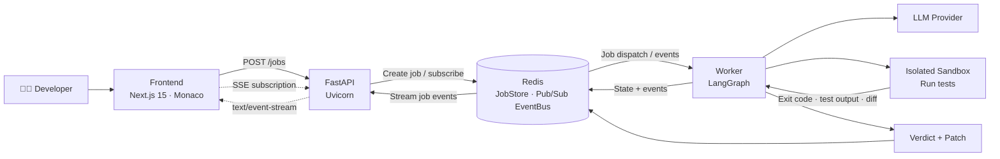
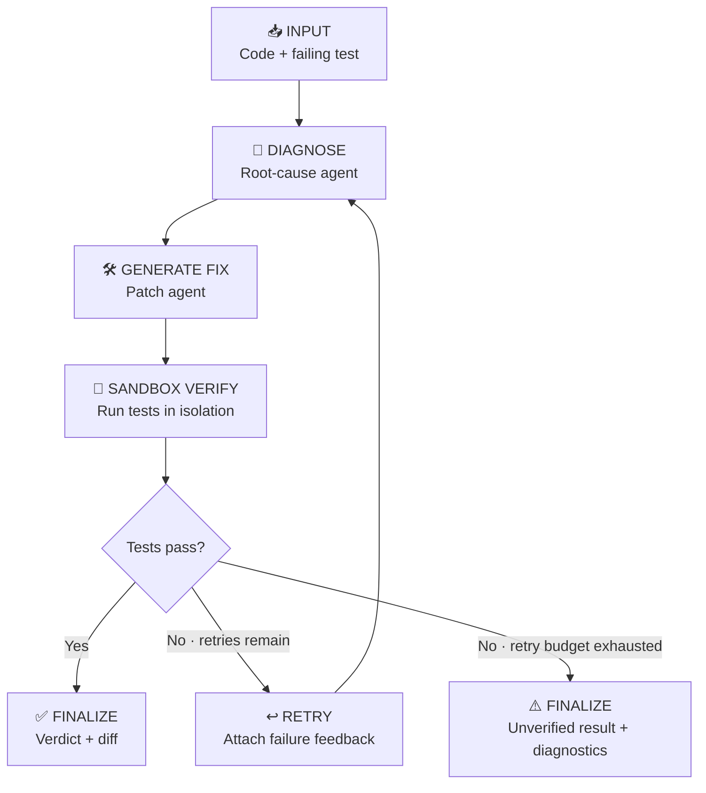

# 🧪 TestPilot AI


**One file. One fix. Verified.** TestPilot AI turns a failing test and its code context into a proposed patch, runs verification in an isolated sandbox, and streams the execution lifecycle back to the developer.

---

## 🏗️ System Architecture

The frontend submits a job to the API. Redis separates durable-enough job state and event distribution from request handling; the LangGraph worker executes the agent workflow and delegates test execution to an isolated sandbox.



### Architecture responsibilities

| Component | Responsibility |
|---|---|
| **Next.js 15** | Code workspace, job submission, live progress, patch and verdict presentation. |
| **FastAPI + Uvicorn** | Validates requests, exposes job and event-stream endpoints, and coordinates job lifecycle operations. |
| **Redis JobStore** | Tracks job state and results with a configured TTL, decoupling job status from API process memory. |
| **Redis EventBus** | Publishes progress and state-change events between workflow execution and connected clients. |
| **LangGraph worker** | Runs the stateful diagnose → patch → verify workflow with explicit transitions and bounded retries. |
| **LLM provider** | Supports diagnosis and patch generation; model output is treated as untrusted input. |
| **Sandbox** | Executes validation in an isolated environment and returns test output and process status. |

## 🔁 Agentic Workflow

The workflow is modeled as a stateful LangGraph graph. Verification results determine whether the graph finalizes the result or loops back for a bounded repair attempt.



**State contract:** graph nodes read and update shared typed state containing the input, diagnosis, candidate diff, verification output, retry count, and final verdict. Conditional edges route based on verification status and retry budget; the retry limit prevents unbounded cycles.

## ✨ Key Technical Challenges Solved

### 📡 SSE vs. WebSockets

Job updates are primarily server-to-client, so **Server-Sent Events (SSE)** provide a lightweight, HTTP-native stream with automatic browser reconnection and straightforward proxy compatibility. WebSockets are better suited to bidirectional, low-latency messaging; they add unnecessary protocol and connection-management complexity for a progress feed. Job submission remains a normal HTTP request, separate from the event stream.

### 🔄 Cyclic LangGraph State

Repair requires a controlled cycle rather than a one-pass chain. Explicit state, conditional routing, verification feedback, and a retry budget let the graph revisit diagnosis or patch generation without looping indefinitely. Each transition can emit an event so the UI can explain what the system is doing instead of showing an opaque spinner.

### 🛡️ SSRF Protection

Repository URLs and user-controlled resource references must be treated as untrusted. Defenses should validate allowed schemes and hosts, reject loopback/private/link-local and cloud metadata destinations, resolve and re-check DNS results to reduce rebinding risk, restrict redirects, and enforce outbound network policy at the sandbox boundary. URL validation alone is not a substitute for network-level egress controls.

### 📦 Job and Event Decoupling

Redis separates job lifecycle state from API workers and uses Pub/Sub to distribute live events. Pub/Sub is ephemeral, so clients should be able to recover current status from the JobStore after reconnecting; if replayable event history is required, use a durable stream or event log rather than relying on Pub/Sub alone.

### 🔒 Untrusted Code Execution

Generated patches and repository tests are untrusted workloads. Verification should run with resource limits, timeouts, restricted filesystem access, no ambient secrets, and network access disabled or tightly allow-listed. The API should expose the result and diagnostics—not unrestricted sandbox access.

## 🚀 Local Development

> Configure the frontend, API, Redis, LLM credentials, and sandbox runtime according to the environment variables supported by each application.

Typical development commands:

```bash
# Backend
pip install -r requirements.txt
uvicorn app.main:app --reload

# Frontend
pnpm install
pnpm dev
```

Start Redis locally with Docker when it is not already available:

```bash
docker run --rm --name testpilot-redis -p 6379:6379 redis:7-alpine
```

## 🌐 Deployment

- **Live Frontend:** [https://testpilot-chi.vercel.app]
- **Live API:** [https://testpilot-9bs7.onrender.com]

---

<p align="center">
  <strong>TestPilot AI</strong><br/>
  From failing test to verified fix—with every step visible.
</p>
#
